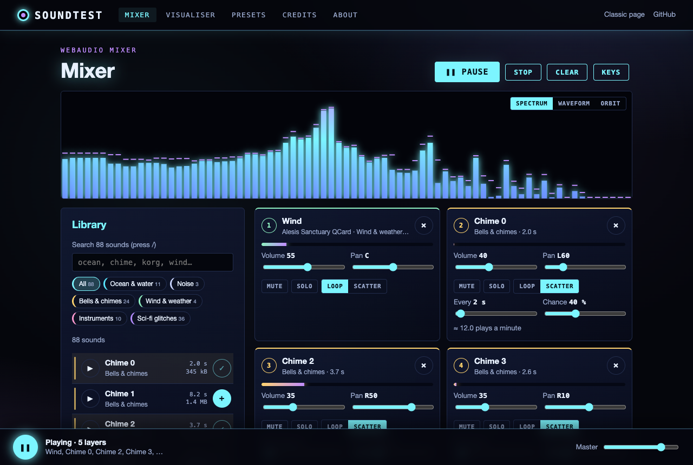
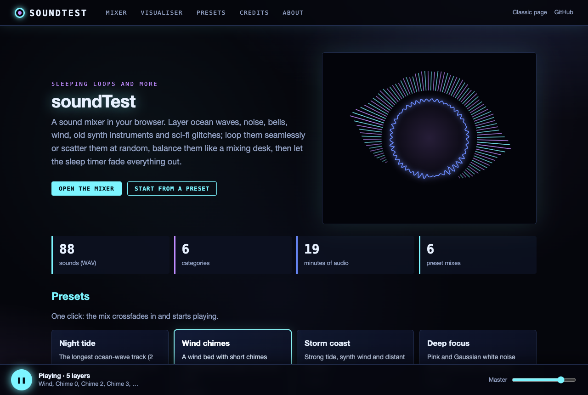
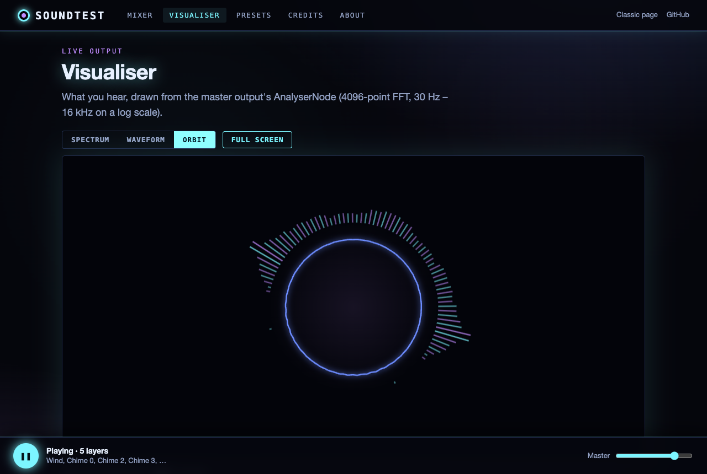
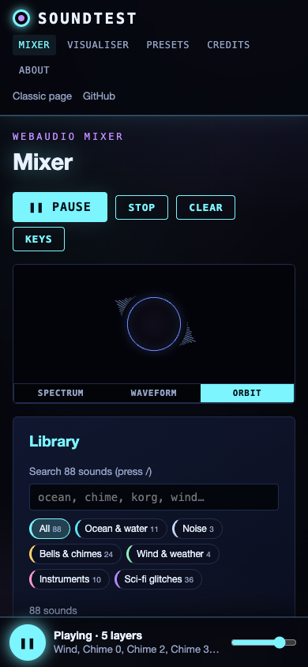
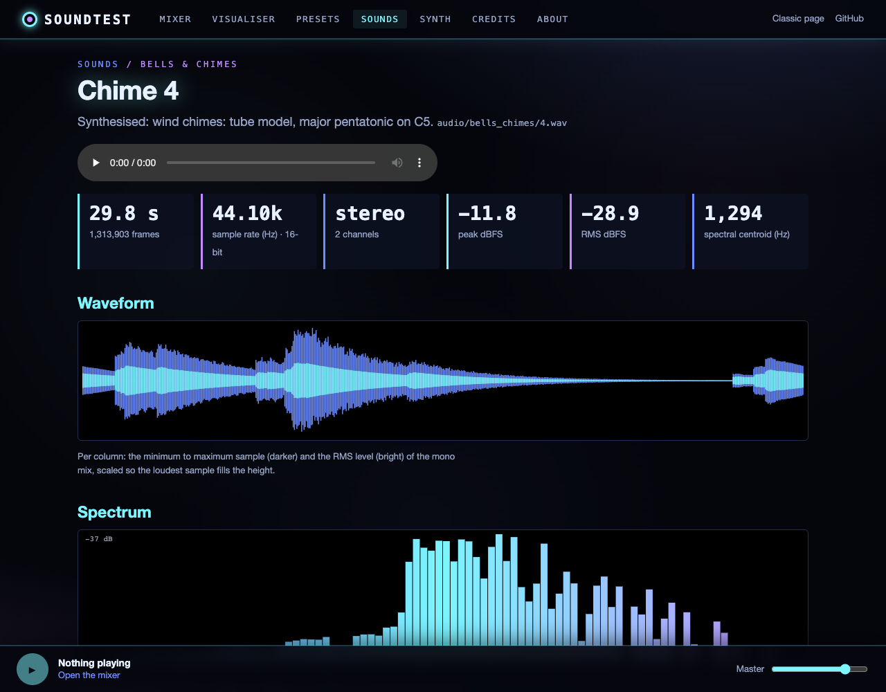
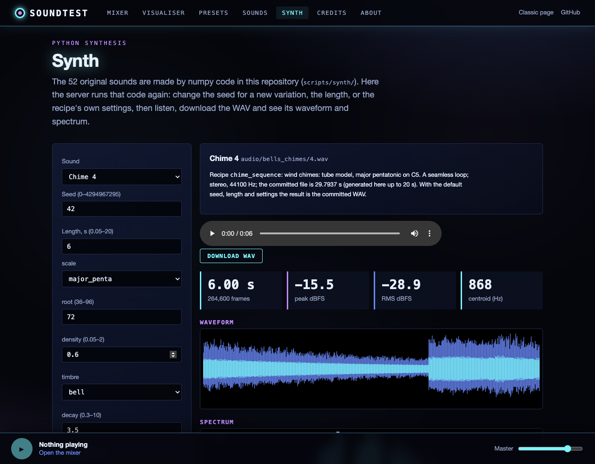
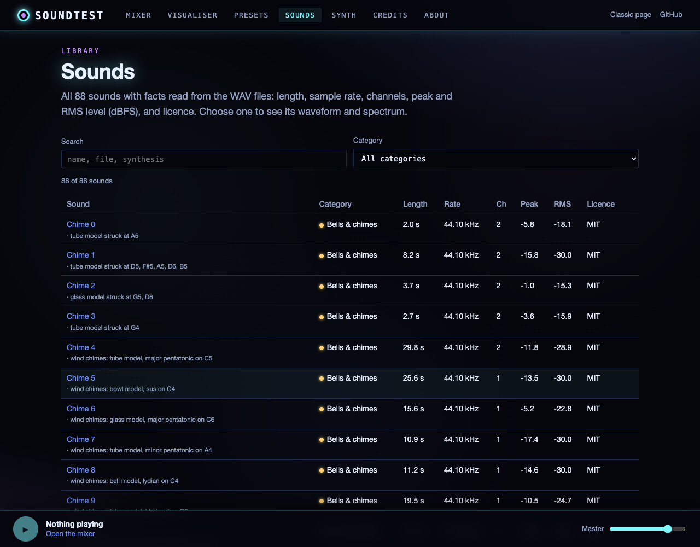
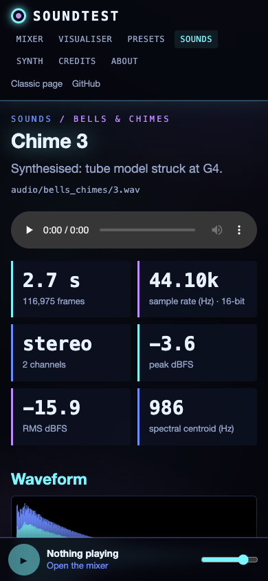

# SoundTest

*Sleeping loops and more.* A sound mixer that runs in your browser: layer ocean waves, noise, bells, wind, old synth
instruments and sci-fi glitches, loop them seamlessly or scatter them at random, balance them like a mixing desk, and
let a sleep timer fade everything out.

**Live:** [https://gddickinson.github.io/soundTest/](https://gddickinson.github.io/soundTest/) ·
the original page: [classic/](https://gddickinson.github.io/soundTest/classic/)



| Home | Visualiser (orbit) | Phone |
|---|---|---|
|  |  |  |

## Features

- **88 sounds in 6 categories**: ocean & water (11), noise (3), bells & chimes (24), wind & weather (4),
  instruments (10) and sci-fi glitches (36), with search and category filters. About 19 minutes of audio.
- **Mixer** (WebAudio): per-layer volume, pan, mute and solo, live level meters, master volume, up to 24 layers.
  Changes glide instead of clicking, and a gentle limiter on the master stops many layers from clipping.
- **Seamless loops**: each loop's last 1.5 s is crossfaded (equal power) into its start, then played with
  `AudioBufferSourceNode.loop`, so the loop point is sample-accurate and has no click at the seam.
- **Scatter mode** for short sounds: every N seconds (±25 %) the sound plays with a chance you set. With 2 s and 40 %
  this is the original page's chime loop. Hits are scheduled ahead on the audio clock.
- **Crossfades**: loading a preset or saved mix crossfades from what is playing over 2.5 s.
- **Sleep timer**: 5 minutes to 2 hours, fading out gradually over the last 1–30 minutes (a smooth curve on its own
  gain stage), then pausing.
- **Presets, saved mixes and share links**: six built-in mixes; mixes saved in your browser (`localStorage`); and the
  address bar always holds a link that rebuilds the current mix exactly.
- **Live visualiser**: spectrum (log-frequency bars with peak caps), waveform and orbit views of the master output,
  on the mixer page and full screen.
- **Small, lazy downloads**: a sound is downloaded only when it is used, with progress per file and in the player bar,
  as Opus (Chrome, Firefox, Edge, recent Safari), else AAC (`.m4a`), else the original WAV. Loading every sound costs
  10.8 MB as Opus or 15.0 MB as AAC instead of 127.9 MB of WAV. Encoders add a little silence at the start (priming)
  and end (padding); the player cuts the decoded audio back to the WAV's exact first sample and length using
  `audio/manifest.json`, so loops stay seamless.
- **Keyboard control**: press `?` on any page for the list.

## The sounds

The 36 sci-fi glitches are the Korg DS-8 Sci-Fi Sound Effects Pack (royalty-free). The other 52 sounds are original,
synthesised from scratch by `scripts/synth_sounds.py` (seeded numpy, so it reproduces the committed files exactly) with
the names, lengths, sample rates and channel counts of the recordings they replaced, so presets and links still work:

- **Noise**: uniform and Gaussian white noise; pink noise shaped to 1/f in the frequency domain.
- **Ocean & water**: noise filtered and swelling in waves (roar, crash and foam layers); synth seashores; flowing water from
  hundreds of synthesised bubbles; a water drop (rising-pitch bubble).
- **Wind & weather**: resonant noise bands with slow gusts (two winds); typhoon (gusts plus synthesised rain); thunder
  (crack and rolling rumble).
- **Bells & chimes**: struck tube, church-bell, singing-bowl and glass models (inharmonic partials) playing wind-chime
  sequences in different scales; an FM bell; a gong with 48 blooming partials.
- **Instruments**: plucked strings (Karplus-Strong bass and guitar, sitar with a buzzing bridge), additive flute, bowed
  bass, baritone sax, saw bass and a detuned pad, a snare and a synth drop.

Loops are seamless by construction (whole-period noise and modulation, events wrapped around the loop point); one-shots
start and end in silence. Loudness matches the replaced files (RMS, clamped to −30…−12 dBFS), peaks stay below −1 dBFS.

## How to use

Open the **Mixer**, press `+` next to a sound (or ▶ to preview it once), or start from a **Preset**. Each layer gets a
strip: volume, pan, Mute, Solo, and Loop / Scatter (with "every" and "chance" for scatter). The player bar at the
bottom stays on every page.

| Key | Action |
|---|---|
| Space | Play / pause |
| 1–9, ← / → | Select a layer |
| ↑ / ↓ | Volume of the selected layer (master if there are none) |
| M / S / L | Mute / solo / loop-or-scatter for the selected layer |
| Delete | Remove the selected layer |
| [ / ] | Master volume |
| / | Search the library |
| V | Next visualiser style |
| T | Start / cancel the sleep timer |
| G | Go to the mixer |
| ? | Show the shortcuts |

### Share links

The mix is stored in the URL hash, for example
`#/mixer?mix=v1~m80~ocean-waves-40.70.0.L~chime-3.45.-30.S20x40.s`:
version, master volume %, then per layer `id.volume%.pan%.mode[.flags]`, where mode `L` is loop and `S20x40` is scatter
every 2.0 s with a 40 % chance, and flags `m` = muted, `s` = solo. Unknown sounds and out-of-range values are ignored or
clamped (`static/mix_codec.js`).

## Run locally

### The local app (Python backend)

```bash
git clone https://github.com/gddickinson/soundTest.git
cd soundTest
pip install -r requirements-web.txt      # fastapi, uvicorn, numpy (+ httpx, pytest for the tests)
python run_web.py                        # http://127.0.0.1:8243/ (local only; --port to change)
```

It serves the same site plus a Python API (FastAPI, `web/`). Project Hub starts it the same way (`web.app:app`).

| Endpoint | What it does |
|---|---|
| `GET /api/info` | Counts (88 sounds: 52 original, 36 third-party; 52 can be generated) |
| `GET /api/sounds`, `/api/sounds/{id}` | The catalogue with facts read from each WAV: duration, frames, sample rate, channels, bit depth, peak and RMS (dBFS), licence, file sizes per format |
| `GET /api/sound/{id}?format=wav\|opus\|m4a` | The audio file (`audio/wav`, `audio/ogg`, `audio/mp4`), with HTTP range requests (206) for seeking |
| `GET /api/analyse/{id}?bins=&nfft=&bands=` | numpy analysis of the WAV: levels per channel, waveform peaks (min/max/RMS per column), averaged Hann-windowed spectrum in log-spaced bands, centroid and loudest frequency |
| `GET /api/synth` | The 52 original sounds with their recipe, defaults and the bounds of every adjustable setting |
| `POST /api/synth` | `{"id", "seed", "duration", "params"}` → a WAV generated by the repo's own synthesis code (`scripts/synth/`). Only listed settings within their bounds, 0.05–20 s, one render at a time; anything else is a 422. With the defaults it reproduces the committed file |

Two pages use it: **Sounds** (`#/sounds`, the catalogue table; `#/sounds/<id>`, waveform and spectrum) and **Synth**
(`#/synth`: pick a sound, change seed, length or recipe settings, generate, listen, download, see its analysis).



| Synth (local app) | Sounds | Phone |
|---|---|---|
|  |  |  |

### Static site (no Python)

The GitHub Pages site is this folder served as it is. `index.html` sets `window.APP_STATIC = true` (the local app
serves it with `false`); `static/static_api.js` then answers the API from `api/*.json` (exported from the real API by
`python scripts/export_api.py`; a test fails if they are stale) and runs the analysis in the browser
(`static/analysis.js`, on the WAV for files up to 4 MB, else on the decoded Opus/AAC copy). The JS uses the same
definitions as `web/analysis.py`, and `tests/analysis.test.mjs` checks it against the Python results on excerpts of real
WAVs (`tests/fixtures/analysis.json`, agreement to 1e-9). Generating sounds needs
the local app. Any static server works:

```bash
python3 -m http.server 8000      # open http://localhost:8000/
```

Opening `index.html` straight from disk does not: browsers block ES modules and audio fetches from `file://`.

## Tests

```bash
node --test tests/*.test.mjs       # mix links, sleep fade, seamless loops, scatter, sound catalogue, classic page
python -m pytest -q tests/         # web API (tests/test_web.py) + Playwright smoke test (needs playwright and Chrome/Chromium)
python scripts/export_api.py       # refresh api/*.json for the static site after changing sounds or the API
python scripts/make_analysis_fixture.py  # refresh tests/fixtures/analysis.json (Python results the JS must match)
node scripts/make_catalog.mjs      # regenerate static/catalog_data.js after adding/removing WAVs
python scripts/synth_sounds.py     # regenerate the 52 original sounds (numpy; --check compares with the WAVs)
python3 scripts/compress_audio.py  # (re)make the .opus/.m4a copies and audio/manifest.json (needs ffmpeg with libopus)
python scripts/screenshots.py --static          # every page, static site: no console errors, no overflow at 390 px
python scripts/screenshots.py --base http://127.0.0.1:8243   # the same against the running local app
python scripts/screenshots.py --static --readme --phone      # refresh the README's mixer/visualiser shots
```

The smoke test serves the repository with `python -m http.server`, opens every page (no console errors, no horizontal
scroll at 390 px), plays a preset and checks that sound comes out and the loops are crossfaded, rebuilds a mix from a
share link, drives mute/solo/volume from the keyboard, runs a 4-second sleep timer, and clicks through the classic page.
It also decodes a few sounds as WAV, Opus and AAC (at 44.1 and 48 kHz) with the site's loader and checks the copies have
the WAV's exact length and line up with it at the first and last samples (Chrome; WebKit too when Playwright's WebKit is
installed).

## Project structure

```
soundTest/
├── index.html            # the site (hash router: #/, #/mixer, #/visualiser, #/presets, #/sounds, #/synth, #/credits, #/about)
├── run_web.py            # starts the local app (uvicorn, 127.0.0.1:8243)
├── web/                  # FastAPI app: app.py (routes), catalogue.py, analysis.py (numpy), synth_api.py
├── api/                  # the API's GET answers as JSON for the static site (scripts/export_api.py)
├── static/               # ES modules + styles (see INTERFACE.md for a file-by-file map)
├── classic/              # the original page (index.html, script.js, style.css), bugs fixed
├── audio/                # 88 WAVs (masters) + .opus/.m4a copies + manifest.json + generated.json
├── scripts/              # synth_sounds.py + synth/ (the 52 original sounds), make_catalog.mjs, compress_audio.py,
│                         # screenshots.py
├── tests/                # node tests (*.test.mjs), test_web.py (API), test_synth.py, Playwright smoke test (test_smoke.py)
└── docs/img/             # screenshots
```

## The classic page

The first version is kept at [`classic/`](classic/): choose Chimes, White Noise or Ocean Sounds; Play Sample, Play Loop
(chimes: a random chime every 2 s with a 40 % chance, sometimes two), Start Analyser (nine bars; it always analyses
the ocean recording) and Stop. These bugs were fixed in it:

- chime 19 could never be picked (`getRndInteger(0, 19)` excludes 19);
- Play Sample / Play Loop before choosing a sound threw an error;
- channels were never freed if a WAV's duration was not known yet, so playback stopped after 10 clicks;
- Stop after Start Analyser threw `audioCtx is not defined`; the analyser could not be restarted; it ran two render
  loops and logged to the console on every frame;
- the page downloaded all 22 of its WAVs (~47 MB) on every visit (`preload="auto"`).

## Browser compatibility

Any current browser with the Web Audio API and ES modules (Chrome, Edge, Firefox, Safari).

## Ideas

- More visualiser styles; per-layer EQ.

## Contributing

Contributions to SoundTest are welcome! Feel free to submit pull requests or open issues with suggestions for improvements.

## License

Released under the [MIT licence](LICENSE). 52 of the 88 sounds are original (synthesised by `scripts/synth_sounds.py`)
and under the same MIT licence; the 36 Korg DS-8 glitches are third-party, royalty-free: see [THIRD_PARTY.md](THIRD_PARTY.md)
and the site's Credits page.

## Credits

Developed by G.D. Dickinson

---

*SoundTest - Audio loops and visualization for relaxation, focus, and sleep*
